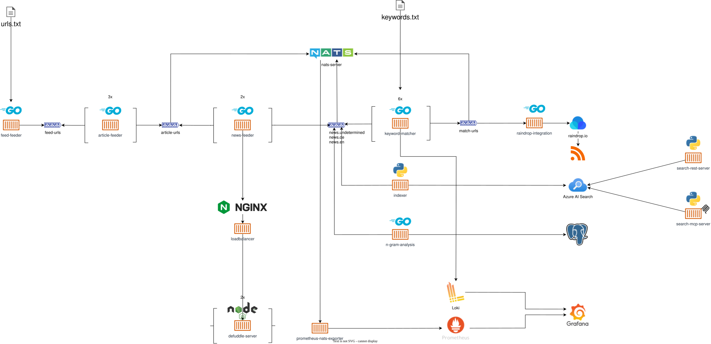
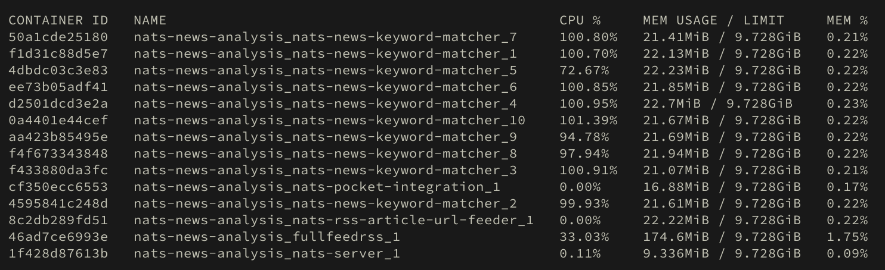
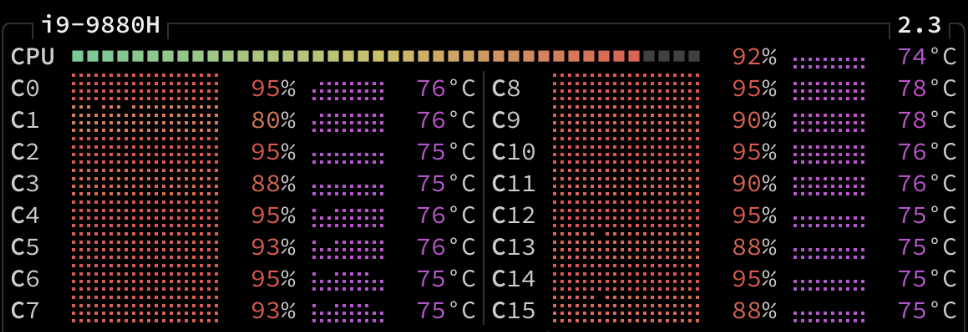
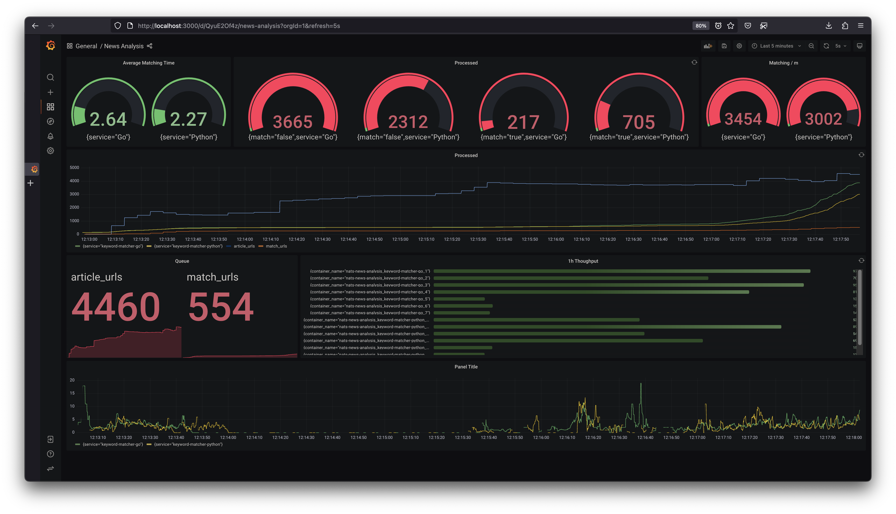

Fragt systematisch Online-Nachrichtenartikel ab, reichert sie an, sucht nach Schlagworten und sendet Treffer zu [raindrop.io](https://raindrop.io/). Alle Komponenten sind lose mit [NATS.io](https://nats.io/) queues gekoppelt, was es auch erlaubt, Single-Core-CPU-intensive Komponenten einfach zu skalieren.

[In Draw.io öffnen](https://app.diagrams.net/?url=https://raw.githubusercontent.com/heussd/nats-news-analysis/main/architecture.drawio.svg)

Das System hat die folgenden NATS-Queues:

1. `feed-urls` - URLs von RSS-Feeds.
1. `article-urls` - URLs einzelner Artikel aus RSS-Feeds.
1. `news` - Nachrichtentexte und ihre Metadaten.
1. `match-urls` - URLs positiv gematchter Artikel.

Die Ergebnisse dieses Systems sind:

1. Eine Raindrop.io-Collection mit Artikeln, die auf Schlagworte passen.
1. Ein Azure AI Search Index, vorbereitet für hybride Suche auf Nachrichten.
1. Ein REST- und MCP-Server, um den Suchindex mit einem Agenten zu nutzen.
1. Eine PostgreSQL-Zeitreihendatenbank mit n-Gramm-Statistiken englischsprachiger Nachrichten.
1. Eine Sammlung von Jupyter Notebooks zur Auswertung von Trends, Quellen, Sprachen und Phrasen.
1. Ein Grafana-Dashboard mit Metriken.

## Beteiligte Services

Alle Services werden mit `compose.yml` orchestriert und skaliert.

### Eigene Services

| Service | Sprache | Beschreibung |
| ------------------------------------------------------------------------------------- | ------- | ------------------------------------------------------------------------------------------------ |
| [feed-feeder](https://ghcr.io/heussd/nats-news-analysis/feed-feeder) | Golang | Liest RSS-Feed-URLs aus einer Textdatei ein. |
| [article-feeder](https://ghcr.io/heussd/nats-news-analysis/article-feeder) | Golang | Liefert Artikel-URLs aus RSS-Feeds. |
| [news-feeder](https://ghcr.io/heussd/nats-news-analysis/news-feeder) | Golang | Ruft Nachrichten ab und liefert Artikelinhalt samt Metadaten. |
| [keyword-matcher](https://ghcr.io/heussd/nats-news-analysis/keyword-matcher) | Golang | Gleicht gegen eine Schlagwortliste ab. |
| [n-gram-analysis](https://ghcr.io/heussd/nats-news-analysis/n-gram-analysis) | Golang | Erzeugt n-Gramm-Statistiken englischsprachiger Nachrichten und speichert sie in einer Zeitreihen-DB. |
| [nats-indexer](https://ghcr.io/heussd/nats-news-analysis/nats-indexer) | Python | Indexiert Nachrichten und ihre Metadaten. |
| [raindrop-integration](https://ghcr.io/heussd/nats-news-analysis/raindrop-integration) | Golang | Veröffentlicht Treffer auf [raindrop.io](https://raindrop.io/). |
| [defuddle-server](https://ghcr.io/heussd/defuddle-server) | Node | Extrahiert den Volltext von Webseiten. |
| [search-rest-server](https://ghcr.io/heussd/nats-news-analysis/search-rest-server) | Python | Stellt eine REST-API zum Abfragen des Azure AI Search Index bereit. |
| [search-mcp-server](https://ghcr.io/heussd/nats-news-analysis/search-mcp-server) | Python | Stellt einen MCP-Server bereit, um den Suchindex mit einem Agenten zu nutzen. |

### Fremd-Services

- [docker.io/nats](https://hub.docker.com/_/nats) - Event-Queue, Key-Value-Store und Deduplizierung.
- [PostgreSQL](https://www.postgresql.org/) - Zeitreihenspeicher für n-Gramm-Statistiken.
- [NGINX](https://www.nginx.com/) - Einfacher Load Balancer / Reverse Proxy.
- [Prometheus NATS Exporter](https://github.com/nats-io/prometheus-nats-exporter) - Macht NATS-Metriken für Prometheus verfügbar.
- [Prometheus](https://prometheus.io/) - Metriken & Monitoring.
- [Grafana Loki](https://grafana.com/oss/loki/) - Log-Aggregation.
- [Grafana](https://grafana.com/grafana/) - Dashboard für Metriken und Statistiken.
- [Watchtower](https://github.com/nicholas-fedor/watchtower) - Hält Container aktuell.

## Message Queue zum Skalieren

Statt die Anwendung mit einer Single-Core-Schlagwortsuche zu blockieren oder ein komplexes Multi-Threading zu bauen, nutzen wir die `scale`-Option von Docker Compose, um mehrere Single-Core-Komponenten parallel laufen zu lassen, verbunden über die Message Queue. So bleiben die einzelnen Komponenten sehr einfach und leicht wartbar.

### Hochskalierte keyword-matcher-Container

### Ein Core pro Schlagwortsuche

## N-Gramm-Analyse

Englischsprachige Artikel werden in 1- bis 4-Gramme zerlegt (Stoppwörter entfernt) und über die Zeit in einer PostgreSQL-Zeitreihendatenbank gezählt. Die Jupyter Notebooks in `notebooks/` fragen diese Datenbank ab und visualisieren Trends, News-Puls, Quellenlandschaft, Sprachverteilung, Phrasen-Tracking und Vokabularwachstum.

## Observability

Ein typischer Prometheus-Loki-Grafana-Stack überwacht Anwendungsmetriken und Statistiken.

NATS-Server-Statistiken werden über den [Prometheus NATS Exporter](https://github.com/nats-io/prometheus-nats-exporter) für Prometheus verfügbar gemacht.

Die keyword-matcher-Container nutzen zerolog und schicken ihre Logs [über den Docker-Loki-Logging-Driver an Loki](https://yuriktech.com/2020/03/21/Collecting-Docker-Logs-With-Loki/).

Ein Grafana-Dashboard ist im Repository enthalten.

## Python im Vergleich zu Golang

Als eine der Kernkomponenten für die eigentliche Analyse wurde der keyword-matcher aus Spaß und zu Forschungszwecken von Python nach Golang portiert. Beide Implementierungen können nebeneinander laufen oder gegeneinander antreten:

    NAME                                                 CPU %     MEM USAGE / LIMIT
    loki                                                 1.33%     74.55MiB / 7.667GiB
    nats-news-analysis_fullfeedrss_1                     0.00%     76.68MiB / 7.667GiB
    nats-news-analysis_fullfeedrss_2                     0.01%     70.62MiB / 7.667GiB
    nats-news-analysis_grafana_1                         0.17%     35.95MiB / 7.667GiB
    nats-news-analysis_keyword-matcher-go_1              0.00%     8.051MiB / 7.667GiB
    nats-news-analysis_keyword-matcher-go_2              0.00%     8.422MiB / 7.667GiB
    nats-news-analysis_keyword-matcher-go_3              0.00%     8.781MiB / 7.667GiB
    nats-news-analysis_keyword-matcher-go_4              0.00%     8.059MiB / 7.667GiB
    nats-news-analysis_keyword-matcher-python_1          0.00%     22.64MiB / 7.667GiB
    nats-news-analysis_keyword-matcher-python_2          0.00%     23.21MiB / 7.667GiB
    nats-news-analysis_keyword-matcher-python_3          0.00%     24.23MiB / 7.667GiB
    nats-news-analysis_keyword-matcher-python_4          0.00%     23.8MiB / 7.667GiB
    nats-news-analysis_loadbalancer_1                    0.00%     2.316MiB / 7.667GiB
    nats-news-analysis_nats-server_1                     1.34%     92.97MiB / 7.667GiB
    nats-news-analysis_natsexporter_1                    0.03%     7.41MiB / 7.667GiB
    nats-news-analysis_pocket-integration_1              0.00%     18.41MiB / 7.667GiB
    nats-news-analysis_prometheus_1                      0.00%     37.22MiB / 7.667GiB
    nats-news-analysis_rss-article-url-feeder-go-1st_1   0.05%     15.32MiB / 7.667GiB
    nats-news-analysis_rss-article-url-feeder-go-2nd_1   11.46%    12.95MiB / 7.667GiB

Einige interessante Zahlen aus Docker und Loki, erhoben im regulären Betrieb:

| Metrik             | Python  | Golang  | Vergleich                          |
| ------------------ | ------- | ------- | ---------------------------------- |
| Docker-Image-Größe | 424MB   | 6.09MB  | Go-Impl. ist ~70x kleiner          |
| Speicherverbrauch  | 23,8MiB | 8,33MiB | Go-Impl. braucht ~3x weniger RAM   |
| LoC                | 447     | 485     | Python-Impl. hat ~8% weniger Zeilen |
